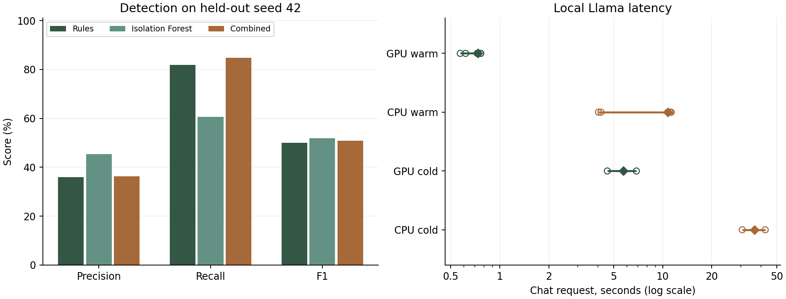

# Stage 7 experiments

On 19 November 2026 the combined detector caught 56 of 66 suspicious scenarios in the canonical test period. The rules caught 54 and Isolation Forest caught 40. The union also produced the most false event alerts per 1,000 logins. The paired briefing audit and workstation benchmark below measure different parts of the investigation workflow.

[Measurements and browser evidence](stage7-measurements.zip) · [Independent reviewer packets](stage7-blind-review.zip) · [Night Desk](README.md#open-night-desk)



The left panel uses seed 42. In the latency panel circles are individual chat requests and diamonds are medians. The time axis is logarithmic.

## Detection

The unit for TP, FP, FN and TN is a simulated scenario. A single scenario receives detection credit once if it owns a triggering event. False alerts per 1,000 and workload count triggering events, including repeated triggers. The combined detector takes the union at the event level. All runs used the original four rules and the same 200-tree Isolation Forest configuration, with scikit-learn 1.8.0. For each synthetic organization the model fit the earlier 28-day period. The next 14 days fixed its threshold using the existing rules' alert budget. The final 14 days provided the test events. The briefing model had no role in detection.

| Seed 42 detector | TP | FP | FN | TN | Precision | Recall | F1 | Event alerts | False alerts / 1k events |
| --- | ---: | ---: | ---: | ---: | ---: | ---: | ---: | ---: | ---: |
| Rules | 54 | 96 | 12 | 988 | 36.0% | 81.8% | 50.0% | 187 | 69.66 |
| Isolation Forest | 40 | 48 | 26 | 1,036 | 45.5% | 60.6% | 51.9% | 157 | 37.19 |
| Combined | 56 | 98 | 10 | 986 | 36.4% | 84.8% | 50.9% | 261 | 82.05 |

| Seed 42 scenario family | Test scenarios | Rules flagged | Forest flagged | Combined flagged |
| --- | ---: | ---: | ---: | ---: |
| Approved travel | 30 | 27 | 23 | 27 |
| Guess sequence | 23 | 18 | 15 | 20 |
| Failures across accounts | 20 | 18 | 14 | 18 |
| Password mistake | 92 | 54 | 11 | 56 |
| Routine login | 948 | 1 | 0 | 1 |
| Shared gateway | 14 | 14 | 14 | 14 |
| Unusual account use | 23 | 18 | 11 | 18 |

The two additional suspicious scenarios recovered by combining detectors were both guess sequences. Every detector flagged all 14 benign shared-gateway scenarios. The experiment deliberately makes approved travel and unusual account use observationally similar.

| Sensitivity run | Test scenarios | Threshold | Rules recall / F1 | Forest recall / F1 | Combined recall / F1 |
| --- | ---: | ---: | ---: | ---: | ---: |
| Seed 42 | 1,150 | 0.621293 | 81.8% / 50.0% | 60.6% / 51.9% | 84.8% / 50.9% |
| Seed 43 | 1,147 | 0.613911 | 92.6% / 59.2% | 76.5% / 66.2% | 94.1% / 59.3% |
| Seed 44 | 1,163 | 0.605374 | 81.4% / 49.5% | 62.7% / 49.3% | 84.7% / 50.0% |

The combined detector had the highest recall in each seed. Isolation Forest had the fewest false alerts per 1,000 in each seed. These are three draws from one generator. Rates in a real organization depend on its activity and incident prevalence. The archive contains per-seed confusion counts, false-alert rates, family breakdowns and manifest hashes in `detectors.json`.

## Briefing quality and human review

We selected 20 distinct files from the 192 seed-42 cases by cycling through sorted profiles of fired rules, model decisions and candidate techniques, taking the earliest remaining file from each profile. Neither labels nor the Llama answers were consulted to select cases. This deliberately diverse sample is unweighted. Both methods received the same case. The template selects one lead. Llama can select up to two. Each fact is rendered by the same code.

| Automated measurement on the same 20 cases | Template | Local Llama |
| --- | ---: | ---: |
| Briefings returned | 20 / 20 | 20 / 20 |
| Facts with exact supporting references and a successful trigger replay | 43 / 43 | 51 / 51 |
| Distinct trigger and signal pairs covered across cases | 43 / 60 (71.7%) | 51 / 60 (85.0%) |
| Cases naming a gap for the primary trigger | 20 / 20 | 20 / 20 |

The follow-up differed in 8 of 20 files. Support requires the exact reference set for the signal, source records within the case and a fresh replay of its triggering event. Coverage counts one available observation per trigger and fired rule, plus one forest observation per trigger. These measures assess the rendered facts and citation path. The option to select a second lead can increase coverage by design. Independent reviewers assess how useful the gaps and recommended checks are to an analyst.

**Independent human ratings are pending.** Each reviewer receives 20 pairs with shuffled case order and balanced A/B source positions. The reviewers receive source records, the two unlabeled briefings and independent CSVs. They score the specificity of missing information (0–2) and usefulness for triage (1–5). Ties are allowed. Send only the assigned R1 or R2 folder from the reviewer archive to each person. Keep the measurements archive and report with the organizer until both sheets are returned. The scorer rejects incomplete or duplicate sheets. Its unit tests use synthetic ratings solely to check the scorer.

## Matched CPU and GPU benchmark

Workstation: AMD Ryzen 5 3600X (6 cores), NVIDIA GeForce RTX 2070 (8 GiB), driver 621.14, Ollama 0.40.16. Every request used `llama3.1:8b-instruct-q4_K_M` with digest `46e0c10c039e019119339687c3c1757cc81b9da49709a3b3924863ba87ca666e`. Temperature 0, seed 42, context 4,096, output cap 256. CPU requested zero GPU layers. GPU used the workstation's ordinary automatic placement. Each response was accepted only with the expected VRAM placement and digest.

| Measured quantity | CPU | RTX 2070 |
| --- | ---: | ---: |
| Cold chat seconds (two runs) | 42.535, 30.747 | 6.892, 4.575 |
| Median cold chat seconds | 36.641 | 5.734 |
| Median warm chat seconds (six runs) | 10.766 | 0.734 |
| Median warm output tokens per second | 6.54 | 48.34 |
| Median cold model-load seconds | 13.353 | 4.669 |
| Model bytes reported by the runtime | 5,584,516,545 | 5,280,104,447 |
| Of those, bytes in VRAM | 0 | 5,280,104,447 |

Four device blocks ran in CPU, GPU, GPU, CPU order. Each began with the target model absent from the running-model list. A request for the worked two-trigger file measured cold latency, including loading. Three further requests per block covered that case, a shared-source failure and a forest-only case. The second repetition reversed warm order on both devices. The warm medians give a **14.7×** wall-time speedup on this workload. Tokens per second uses generated-token count divided by generation time. Chat timing excludes casebook construction, placement lookup and UI rendering. Cold denotes unloaded model weights in Ollama; OS disk caching was uncontrolled. The memory figures describe the loaded model, not peak system memory. Small sample sizes and prompt caching can affect these numbers. See `runtime.json` for individual latencies and token counts.

## Night Desk acceptance

1. Started the local server on port 8817 with the canonical seed-42 queue.
2. In the browser, imported a seed-43 ZIP containing only the manifest and three event streams. The queue showed seed 43. File 001 opened the failed authentication at 06:29:16 UTC in `events/test.jsonl:4`.
3. Requested a live local Llama briefing. Pinned line 4, filed a **Monitor** decision with a reason, and opened the debrief.
4. Stopped the server process, started a fresh process on the same port and reloaded the imported URL. The dataset fingerprint, filed status, disposition, reason and pinned source line were restored. The saved browser capture is `browser-restart.jpg` in the measurements archive.

The server persists imported event streams under the manifest digest. The browser persists analyst decisions under the same origin and digest. Opening a different browser profile or port uses a different assessment store. An initial Windows staging-directory failure was corrected before the successful run.

## Reproduce and finish sign-off

In a fresh checkout, use Python 3.13 or 3.14 with [the pinned detector dependencies](requirements-ml.txt). Run from this project directory. The deterministic comparison verifies seeds 42–44 in freshly generated directories and compares results with the recorded artifact. The local GPU experiment additionally requires the model above running in Ollama on the benchmark workstation.

```powershell
python -m pip install -r requirements-ml.txt
python -m unittest -v
python -m generate_dataset --seed 42
python -m experiment_suite detectors runs/stage7-detectors.json
python -m experiment_suite briefings runs/stage7-briefings.json
python -m experiment_runtime runs/dataset-v1-seed-42 runs/stage7-runtime.json
```

For a new blind study, run the first command below with new packet and key filenames. For the published study, extract `key.json` from the measurements archive and score the returned CSVs with that key. The graph can be regenerated with matplotlib 3.10.8 and the last command.

```powershell
python -m blind_review prepare runs/stage7-briefings.json runs/dataset-v1-seed-42 runs/new-packets.zip runs/new-key.json
python -m blind_review score key.json R1/ratings.csv R2/ratings.csv
python -m plot_experiments stage7-measurements.zip stage7-results.png
```

**Outstanding sign-off:** collect both independent reviewer sheets, record their per-method scores and disagreements, and have another teammate record their clean-checkout commit, environment, commands and results. The automated clean-data reproduction runs on both CI Python versions. An independent teammate rerun has not been recorded.
